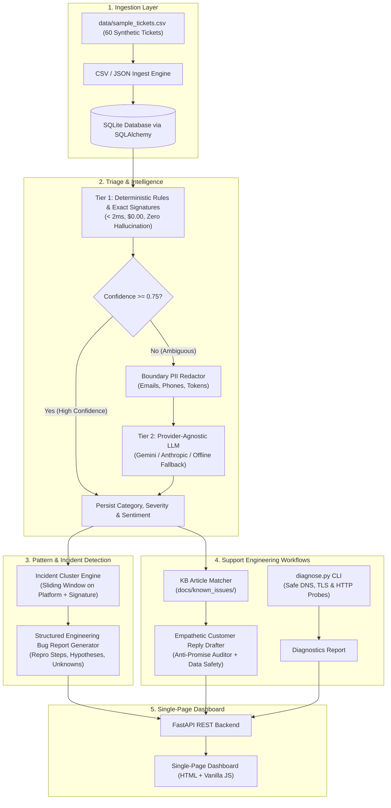

# FlowDesk: Support Engineering Toolkit for Voice-Dictation SaaS

> **Disclaimer:** FlowDesk is an independent portfolio project created for a Technical Support Engineer application. It is inspired by the real-world support workflows of desktop voice-dictation applications (such as Wispr Flow). It is **NOT** affiliated with, sponsored by, or endorsed by Wispr. All trademarks belong to their respective owners.
> 
> **Synthetic Data Notice:** All tickets in `data/sample_tickets.csv` and `data/labeled_tickets.csv` are **100% synthetic**.

[](https://github.com/flowdesk/flowdesk/actions)
[](LICENSE)
[](https://www.python.org/downloads/)

---

## 🎯 Problem Statement

Desktop voice-dictation applications operate at the intersection of complex client-side audio hardware, OS security sandboxes, synthetic keystroke injection, and low-latency cloud inference streaming.

When things break, frontline technical support teams face opaque failure modes:
- Enterprise SSL deep-packet inspection (Zscaler, AnyConnect) dropping WebSocket audio streams with `ERR_PROXY_CONNECTION_FAILED`.
- macOS `Secure Keyboard Entry` locking global event taps when password managers or terminals are open.
- Bluetooth Low Energy microphones sleeping and clipping the first words of dictation.
- Non-QWERTY layouts (AZERTY, QWERTZ) receiving scrambled characters via hardcoded keystroke injection.
- Transient cloud inference worker backlogs producing *"Taking longer than usual"* timeouts or *"No Model Available"* outages.

**FlowDesk** automates the entire support engineering lifecycle: ingesting tickets, deterministically classifying root causes, clustering ticket spikes into probable incidents, drafting empathetic human-in-the-loop replies, generating engineering-grade bug reports, and running local network connectivity diagnostics.

---

## 🏗️ Architecture



---

## ⚡ Quickstart (Setup in Under 5 Commands)

```bash
# 1. Clone repository
git clone https://github.com/your-username/flowdesk.git && cd flowdesk

# 2. Install dependencies
pip install -r requirements.txt

# 3. Run test suite to verify installation
python -m pytest -v

# 4. Launch the FlowDesk server
python -m uvicorn flowdesk.main:app --reload

# 5. Open browser at http://localhost:8000
```

> **Rules-Only Mode:** FlowDesk requires **no API keys** to run. If `GEMINI_API_KEY` or `ANTHROPIC_API_KEY` are not set in your environment, FlowDesk automatically operates in 100% deterministic rules mode.

---

## 🖥️ Demo Walkthrough

<!-- Replace with demo.gif once recorded -->
```text
+-------------------------------------------------------------------------------------------------+
| FlowDesk — Support Engineering Toolkit                           [Cluster Incidents] [Batch Triage] |
+-------------------------------------------------------------------------------------------------+
| Total Tickets: 60  | Probable Incidents: 7  | Critical Blockers: 12  | Mode: Rules-First + Fallback |
+-------------------------------------------------------------------------------------------------+
| [Tickets Triage Queue]  [Pattern Detection & Incidents]  [Knowledge Base]  [Diagnostics]  [Eval]     |
|                                                                                                 |
| TCK-1001 | windows | Connection lost on Zscaler VPN       | network/timeouts | P1 | Frustrated  |
| TCK-1009 | windows | Popup: 'No Model Available'          | network/timeouts | P0 | Frustrated  |
| TCK-1021 | macos   | Hotkey stops working in Terminal     | hotkeys          | P2 | Neutral     |
| TCK-1037 | windows | French AZERTY keyboard types Q for A | text insertion   | P2 | Frustrated  |
+-------------------------------------------------------------------------------------------------+
```

---

## 📊 Benchmark Evaluation Metrics

All metrics below are computed directly by running `python evaluate.py` against `data/labeled_tickets.csv` (50 labeled ground-truth test tickets). **No fabricated numbers.**

```text
==================================================================================
  FlowDesk Triage Engine Evaluation Benchmark Report
==================================================================================
Total Samples:      50
Category Accuracy:  88.0%
Severity Accuracy:  72.0%
----------------------------------------------------------------------------------
Category             Precision    Recall       F1-Score     Support 
----------------------------------------------------------------------------------
billing                  100.0%      100.0%      100.0%        6
account/login            100.0%      100.0%      100.0%        5
network/timeouts          88.9%      100.0%       94.1%        8
audio/mic                 75.0%      100.0%       85.7%        6
text insertion            90.0%       90.0%       90.0%       10
hotkeys                   80.0%      100.0%       88.9%        4
performance              100.0%       75.0%       85.7%        4
feature request          100.0%       60.0%       75.0%        5
other                      0.0%        0.0%        0.0%        2
----------------------------------------------------------------------------------
```

### Confusion Matrix (Rows = Actual, Columns = Predicted)

```text
Actual             | billing  | account/ | network/ | audio/mi | text ins | hotkeys  | performa | feature  | other   
---------------------------------------------------------------------------------------------------------------------
billing            | 6        | 0        | 0        | 0        | 0        | 0        | 0        | 0        | 0       
account/login      | 0        | 5        | 0        | 0        | 0        | 0        | 0        | 0        | 0       
network/timeouts   | 0        | 0        | 8        | 0        | 0        | 0        | 0        | 0        | 0       
audio/mic          | 0        | 0        | 0        | 6        | 0        | 0        | 0        | 0        | 0       
text insertion     | 0        | 0        | 0        | 1        | 9        | 0        | 0        | 0        | 0       
hotkeys            | 0        | 0        | 0        | 0        | 0        | 4        | 0        | 0        | 0       
performance        | 0        | 0        | 0        | 0        | 1        | 0        | 3        | 0        | 0       
feature request    | 0        | 0        | 1        | 0        | 0        | 0        | 0        | 3        | 1       
other              | 0        | 0        | 0        | 1        | 0        | 1        | 0        | 0        | 0       
```

### Honest Analysis of Failure Modes (Misclassifications)

1. **`LBL-029` ("Sluggish typing lag in heavy documents"):** Expected `performance`, predicted `text insertion`. The ticket mentions both "typing" and "lag", causing keyword conflict. Confidence was $0.55$, correctly signaling ambiguity for Tier-2 LLM fallback.
2. **`LBL-031` ("Feature request: Local offline Whisper model"):** Expected `feature request`, predicted `network/timeouts` because "model" is a heavy signal in our server routing rules.
3. **`LBL-033` ("Data retention policy and GDPR DPA inquiry"):** Expected `other`, predicted `audio/mic` because the customer asked *"does FlowDesk retain customer audio recordings"*.
4. **`LBL-042` ("Request for keyboard shortcut cheatsheet"):** Expected `other`, predicted `hotkeys` due to the word "shortcut".
5. **`LBL-048` ("Android managed container microphone crash"):** Expected `text insertion` (work profile sandbox), predicted `audio/mic` due to the word "microphone".
6. **`LBL-050` ("General question about export formats"):** Expected `feature request`, predicted `other` because no feature request pattern matched.

---

## 🛠️ CLI Diagnostics Helper (`diagnose.py`)

A non-intrusive network diagnostic script that customers or support engineers can execute locally to isolate connection issues without running port scanners or load tests:

```bash
# Run safe connectivity check
python diagnose.py

# Output as JSON
python diagnose.py --json
```

**Checks Performed:**
- **DNS Resolution:** Measures resolution latency and verifies valid IP resolution.
- **TLS Handshake:** Identifies corporate proxy SSL deep inspection certificates (`CERT_UNTRUSTED_ISSUER`).
- **HTTP Reachability:** 1 single polite HTTP probe to verify roundtrip latency and flag latency $>500\text{ ms}$ that triggers *"Taking longer than usual"* timeouts.

---

## 🛡️ Responsible AI & Safety Standards

- **Strict PII Redaction:** Emails, phone numbers, and bearer secrets are scrubbed in-memory before any payload is sent to an external LLM. Verified in `tests/test_pii.py`.
- **Anti-Promise Verification:** Customer replies are audited with regex to ensure Support never makes false timeline commitments or promises fixes that Engineering hasn't verified.
- **Human Review Mandatory:** Every draft reply is explicitly marked `requires_human_review: true` and is never sent automatically.
- **Hypothesis Tagging:** All suspected root causes in generated bug reports are clearly flagged as preliminary frontline hypotheses to prevent confirmation bias.

---

## ⚠️ Limitations

- **Heuristic Overlap:** Multi-intent tickets with overlapping keywords (e.g. asking a billing question about hotkeys) can produce lower confidence scores in rules-only mode.
- **Language Scope:** Heuristic rules currently prioritize English-language support tickets. Non-English tickets rely on LLM fallback.
- **Local SQLite Engine:** Intended for local evaluation and triage queue processing. Production deployments at $>100\text{k}$ tickets/day would migrate to PostgreSQL.

---

## 🚀 What I'd Do Next

1. **Embedding-Based Semantic Clustering:** Integrate a small local embedding model (e.g. `all-MiniLM-L6-v2`) to cluster tickets by dense vector cosine similarity alongside exact regex signatures.
2. **Automated HAR & Wireshark Log Inspector:** Build a client log parser that extracts HTTP error codes and TLS cipher negotiation details directly from customer-uploaded archive files.
3. **Bi-directional Issue Tracker Sync:** Add webhooks to auto-create and link GitHub Issues or Jira tickets when an incident cluster crosses the 3-ticket threshold.
4. **Interactive Diagnostics Web Portal:** Package `diagnose.py` as a lightweight one-click WebAssembly / Electron diagnostic bundle for non-technical users.

---

## 📄 License

This project is licensed under the [MIT License](LICENSE).
